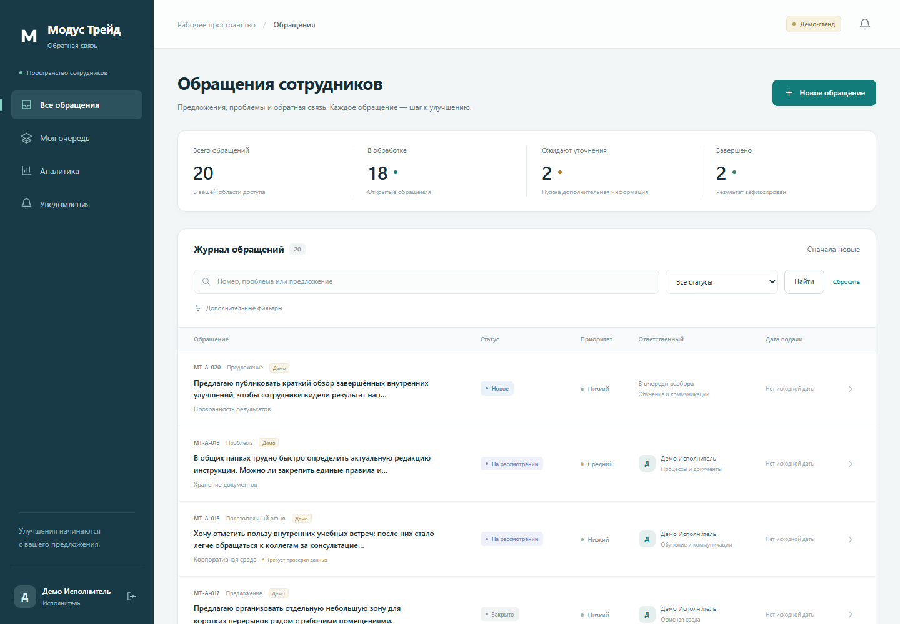

# Обратная связь Модус Трейд

Внутренняя система для предложений, проблем и положительных отзывов сотрудников.
Автор видит ход обработки; ответственные работают с очередью, уточнениями,
решениями и подтверждённым результатом. Все примеры относятся к синтетическому
набору хакатона и не описывают подтверждённые события компании.

## Возможности MVP

- Именные учётные записи и права автора, исполнителя, координатора, руководителя и администратора.
- Регистрация обращения, категоризация, маршрутизация и резервная очередь.
- Отдельный допуск к конфиденциальным обращениям.
- Управляемые состояния, запрос уточнения, решение, результат и повторное открытие.
- История изменений, сообщения автору и внутренние заметки.
- Уведомления внутри системы через transactional outbox.
- Поиск, фильтры, пагинация, рабочая очередь и аналитика.
- Повторяемый импорт 20 исходных карточек с сохранением происхождения и предупреждений.

## Стек



Другие экраны: [аналитика](docs/screenshots/analytics.png),
[вход](docs/screenshots/login.png), [мобильный интерфейс](docs/screenshots/mobile.png).

Python, Django 5.2 LTS, PostgreSQL 17, серверные HTML-шаблоны, CSS и JavaScript.
Приложение — модульный монолит; фоновые задания выполняет отдельный процесс.
WhiteNoise обслуживает локальные статические ресурсы. Внешние CDN не требуются.
Точные зависимости закреплены в `requirements.txt`.

SQLite доступен только для локального демонстрационного режима с `DEBUG=1`.
Для проверки конкурентных операций и пилота используйте PostgreSQL.

## Быстрый локальный запуск Windows

Требуются Python с поддержкой выбранной версии Django и PowerShell.

Для автоматической подготовки окружения и запуска приложения с worker:

```powershell
powershell -ExecutionPolicy Bypass -File .\scripts\dev.ps1
```

Скрипт выполняет установку зависимостей, миграции, загрузку демо и подготовку
статики. Для пошагового запуска используйте команды ниже.

```powershell
python -m venv .venv
.\.venv\Scripts\python.exe -m pip install -r requirements.txt
if (!(Test-Path -LiteralPath .env)) { Copy-Item .env.example .env }
$env:DEBUG = '1'
$env:DEMO_MODE = '1'
$env:DB_ENGINE = 'sqlite'
.\.venv\Scripts\python.exe manage.py migrate
.\.venv\Scripts\python.exe manage.py load_demo
.\.venv\Scripts\python.exe manage.py runserver 127.0.0.1:8000
```

Откройте [локальное приложение](http://127.0.0.1:8000/).
Для постоянной доставки уведомлений запустите во втором терминале:

```powershell
$env:DEBUG = '1'
$env:DEMO_MODE = '1'
.\.venv\Scripts\python.exe manage.py process_outbox --loop
```

Одна обработка очереди: `python manage.py process_outbox --once`.
Значения переменных процесса имеют приоритет над `.env`.

## Запуск с PostgreSQL через Docker Compose

Требуются Docker Engine и Docker Compose. Создайте `.env` из примера и задайте
частные `POSTGRES_PASSWORD` и `APP_DB_PASSWORD`. Контейнеры используют PostgreSQL независимо от
локального значения `DB_ENGINE`.

```powershell
docker compose build migrate
docker compose up -d
docker compose run --rm migrate python manage.py load_demo
```

Приложение доступно по адресу `http://127.0.0.1:8000/`. Сервис `worker` обрабатывает
уведомления. Сервис migrate выполняет миграции от владельца схемы, затем создаёт
отдельную DML-роль для web/worker. Тесты с созданием БД запускайте от владельца
через `docker compose run --rm migrate python manage.py test --noinput`.
База сохраняется в именованном томе. Остановка без удаления данных:

```powershell
docker compose down
```

Если Python запускается на хосте, а PostgreSQL — в Docker, задайте
`DB_ENGINE=postgres`, `POSTGRES_HOST=127.0.0.1` и `POSTGRES_PORT=55432`
(либо значение `POSTGRES_EXPOSED_PORT`). Внутри контейнеров используется порт 5432.

Профиль с HTTPS, ограниченными правами БД, heartbeat, резервированием и инструкцией
восстановления: [docs/operations.md](docs/operations.md). Он запускается отдельно;
политики реальных данных и доступов должны быть утверждены владельцем системы.

## Демо-аккаунты

Пароль новых аккаунтов берётся из `DEMO_PASSWORD`. В локальном режиме разработки
по умолчанию используется `ModusDemo2026!`. При `DEBUG=False` импорт требует
явных `DEMO_MODE=1` и `DEMO_PASSWORD` либо аргумента `--password`.

| Логин | Назначение |
| --- | --- |
| `author` | Сотрудник закупок; видит собственные обращения |
| `author2` | Сотрудник бухгалтерии; другой автор для проверки изоляции |
| `processor` | Исполнитель обычных очередей |
| `coordinator` | Первичный разбор, назначение и конфиденциальная очередь |
| `manager` | Руководитель обычных очередей |
| `admin` | Администратор настроек; роль сама по себе не открывает все обращения |

Дополнительные синтетические авторы: `author_sales`, `author_project`,
`author_lead`, `author_office`, `author_design`. Эти учётные записи созданы для
демонстрации, их нельзя трактовать как реальных сотрудников компании.

Повтор `load_demo` не сбрасывает пароли, не перезаписывает карточки и не возвращает
настройки маршрутов к исходным значениям. Вновь созданный аккаунт получает пароль,
действующий при этом запуске команды.

## Данные и демонстрация

Пошаговый сценарий: [docs/demo.md](docs/demo.md).

Набор [data/demo_requests.json](data/demo_requests.json) содержит 20 исходных карточек,
версию схемы и SHA-256 исходного DOCX. Для запуска исходный файл из Downloads
не требуется. Все исходные строки сохранены в `ImportRecord` и `Ticket.source_data`.

Важные особенности:

- Во всех 20 исходных карточках отсутствует дата подачи; `submitted_at=NULL`.
- Техническое время импорта не подставляется вместо даты обращения.
- A-004 и A-018 направлены на проверку результата; исходные статусы сохранены.
- Для A-008 добавлен явно синтетический результат с тестовым артефактом
  [data/demo_instruction.md](data/demo_instruction.md).
- A-017 демонстрирует явно синтетическое мотивированное решение.
- Вопросы уточнения, плановые сроки, аккаунты и маршруты являются дополнениями демо.
- Пример дальнейшего действия не импортируется как выполненное действие.
- Демонстрационные карточки исключаются из промышленных KPI.

## Переменные окружения

| Переменная | Назначение |
| --- | --- |
| `DEBUG` | Локальная отладка; для пилота `0` |
| `DEMO_MODE` | Явное разрешение демонстрационного режима |
| `SECRET_KEY` | Секрет приложения; пример разрешён только локально |
| `ALLOWED_HOSTS` | Допустимые хосты через запятую |
| `CSRF_TRUSTED_ORIGINS` | Доверенные HTTPS origins при необходимости |
| `BUSINESS_TIMEZONE` | Демо по умолчанию `Asia/Bishkek` |
| `DB_ENGINE` | `sqlite` для локального демо или `postgres` |
| `DB_JIT` | `0` по умолчанию для коротких интерактивных SQL; включать только после измерения |
| `POSTGRES_DB`, `POSTGRES_USER`, `POSTGRES_PASSWORD` | Подключение к PostgreSQL |
| `POSTGRES_HOST`, `POSTGRES_PORT` | Адрес БД для процесса приложения |
| `POSTGRES_EXPOSED_PORT` | Порт БД на хосте Docker, по умолчанию 55432 |
| `APP_DB_USER`, `APP_DB_PASSWORD` | Отдельная роль выполнения web/worker без DDL/superuser |
| `TRUST_PROXY` | Доверие заголовкам только контролируемого закрытого TLS-прокси |
| `OPERATIONS_TOKEN` | Частный Bearer-токен агрегированных метрик |
| `WORKER_HEARTBEAT_MAX_AGE` | Допустимый возраст прохода worker, по умолчанию 120 секунд |
| `RATE_LOGIN_IP`, `RATE_LOGIN_ACCOUNT` | Лимиты входа по IP/логину за пять минут, по умолчанию 20/10 |
| `DEMO_PASSWORD` | Пароль только вновь создаваемых демонстрационных аккаунтов |

Не добавляйте `.env`, локальную БД, файлы пользователей, журналы и секреты в Git.

## Проверки

```powershell
.\.venv\Scripts\python.exe manage.py check
.\.venv\Scripts\python.exe manage.py makemigrations --check --dry-run
.\.venv\Scripts\python.exe manage.py test
.\.venv\Scripts\python.exe -m pip install -r requirements-ci.txt
.\.venv\Scripts\python.exe -m ruff check .
.\.venv\Scripts\python.exe -m mypy
```

Для проверки настроек пилота с его переменными окружения:

```powershell
.\.venv\Scripts\python.exe manage.py check --deploy
```

CI проверяет PostgreSQL, миграции, бизнес-регрессии, синтаксические ошибки Ruff,
типизированные DTO, уязвимости зависимостей, статику и Docker build.
Типизация вводится постепенно: strict-проверка пока охватывает `feedback/contracts.py`.
Протокол исходного аудита: [docs/audit-2026-11-11.md](docs/audit-2026-11-11.md).
Исправления и повторный аудит: [docs/audit-remediation-2026-11-11.md](docs/audit-remediation-2026-11-11.md).

Карта требований и регрессий: [docs/requirements-traceability.md](docs/requirements-traceability.md).
Контракты действий: [docs/command-matrix.md](docs/command-matrix.md).
Стабильный импорт: [docs/import.md](docs/import.md); индексируемый поиск:
[docs/search.md](docs/search.md); методика нагрузки: [docs/load-testing.md](docs/load-testing.md).

Требования производительности, доступности и восстановления являются целями
из ТЗ. Наличие автоматических тестов само по себе не подтверждает их выполнение.

## Документация и ограничения

- [Техническая спецификация](docs/specification.md).
- [Принятые решения и условия пилота](docs/decisions.md).
- [Демонстрационный сценарий](docs/demo.md).
- [HTTP-интерфейс и коды ошибок](docs/http-interface.md).
- [Результаты проверок](docs/verification.md).

В MVP отсутствуют загрузка вложений, корпоративный SSO, реальные обмены с 1С и
Битрикс24, анонимная подача и клиентские опросы. Производственный календарь пока
задаёт пятидневку без праздничных исключений. Рабочие роли и сроки демонстрационные.
Расширенная эксплуатационная инфраструктура, резервирование и нагрузочные
испытания требуют отдельной проверки перед пилотом.

Репозиторий подготовлен для локальной работы; публикация и подключение внешних
корпоративных систем в рамках этого результата не выполняются.
