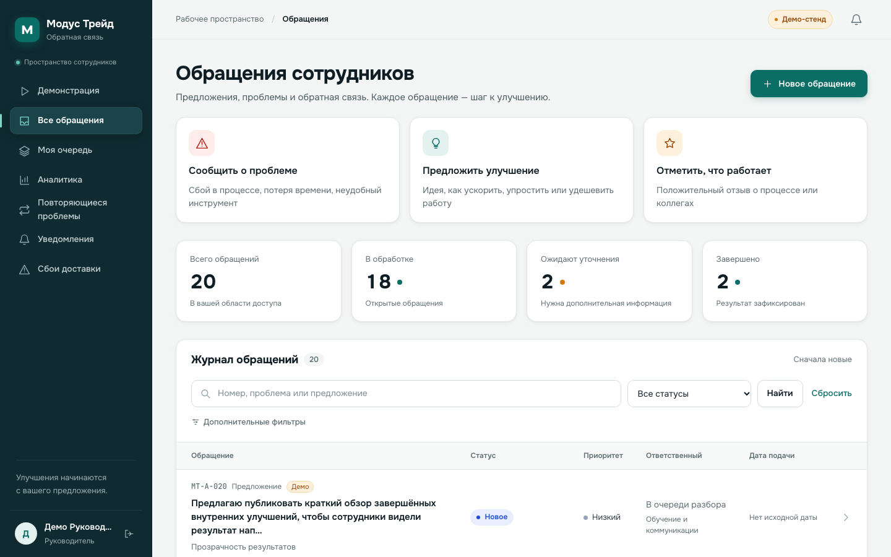
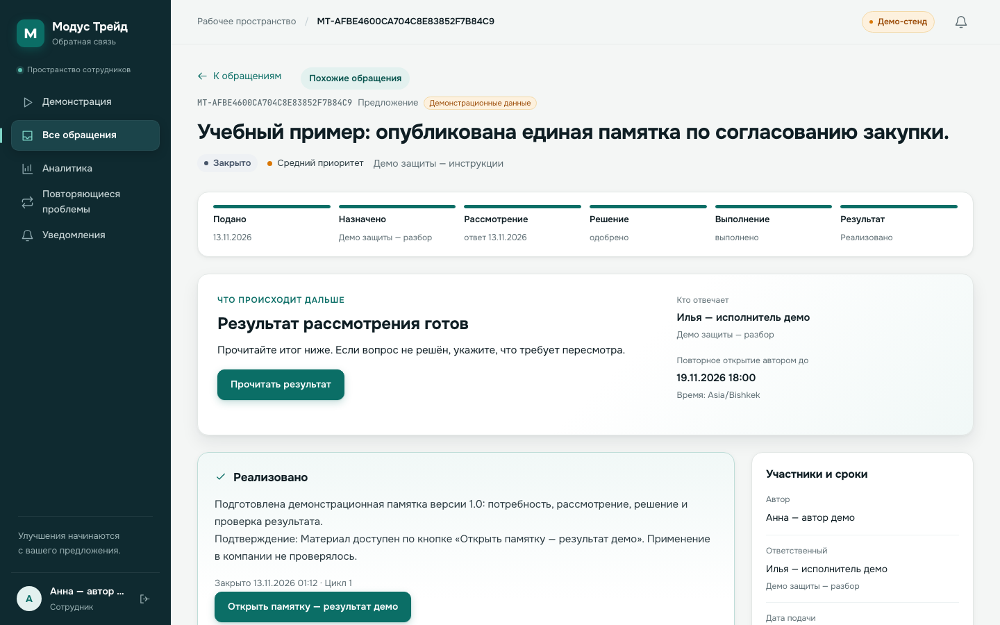
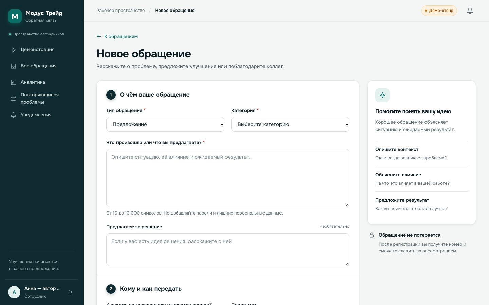
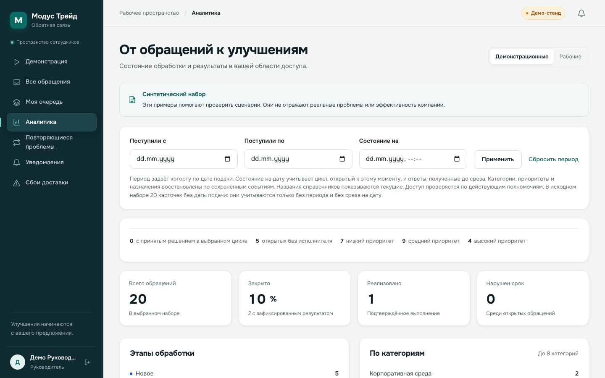

# Обратная связь Модус Трейд

[](https://github.com/fanatlive/modustrade/actions/workflows/ci.yml)

Внутренняя система, в которой сотрудник сообщает о проблеме или предлагает улучшение,
а компания доводит обращение до проверяемого результата: с ответственным, сроками,
уточнениями, решением и историей. Решение подготовлено по ТЗ хакатона ГК «Модус Трейд»
(трек «Система обратной связи и предложений сотрудников»).

**Формат результата — работающий MVP** (ТЗ, раздел 4.3). Все данные в демо синтетические
и не описывают реальные события компании.

## Коротко

- **Проблема.** Предложения и жалобы теряются в почте и чатах, у них нет ответственного и срока,
  автор не знает, чем всё закончилось, а повторяющиеся проблемы не видны.
- **Решение.** Единый путь «подано → назначено → рассмотрение → решение → выполнение → результат»
  с автоматической маршрутизацией, сроками по рабочему календарю, уточнениями у автора,
  разграничением доступа по ролям и сводкой повторяющихся проблем.
- **Проверено.** 165 автоматических тестов (на PostgreSQL 17 проходят все 165),
  браузерные сценарии в Chromium, 30-минутный нагрузочный прогон без ошибок, аудит и протокол
  исправлений. Подробности и ссылки на машинные протоколы — в разделе [«Доказательства»](#доказательства).
- **Запуск** одной командой: `bash scripts/dev.sh`, затем откройте `/demo/`.

## Интерфейс

| Журнал обращений | Карточка: путь обращения и итог |
| --- | --- |
|  |  |
| **Новое обращение** | **Аналитика руководителя** |
|  |  |

Мобильная версия: [журнал](docs/screenshots/design/mobile-list.png),
[карточка](docs/screenshots/design/mobile-detail.png). Вход: [экран входа](docs/screenshots/design/login.png).

## Соответствие ТЗ

### Обязательные результаты (раздел 4.1)

| Требование ТЗ | Где смотреть |
| --- | --- |
| Продуктовая концепция, проблема и ценность | [docs/hackathon/product.md](docs/hackathon/product.md) |
| Целевые пользователи и ключевые сценарии | [product.md — «Пользователи и потребности», «Основной путь»](docs/hackathon/product.md), [сценарий демонстрации](docs/demo.md) |
| Прототип интерфейса с основными экранами и переходами | Работающее приложение; [скриншоты выше](#интерфейс) |
| Техническая концепция: архитектура, данные, безопасность, интеграции | [спецификация](docs/specification.md), [решения](docs/decisions.md), [интеграция с Битрикс24](docs/hackathon/integration.md), [эксплуатация](docs/operations.md) |
| План развития с выделением MVP и этапов | [product.md — «Этапы развития»](docs/hackathon/product.md) |
| Демонстрация и пояснение ограничений | [сценарий защиты](docs/hackathon/presentation.md), страница `/demo/`, [ограничения](#ограничения-mvp) |

### Дополнительные результаты для работающего MVP (раздел 4.2)

| Требование ТЗ | Где смотреть |
| --- | --- |
| Исходный код и репозиторий | Этот репозиторий |
| Инструкция по запуску и демонстрации | [Запуск](#запуск-за-две-минуты), [docs/demo.md](docs/demo.md) |
| Реализованные функции и известные ограничения | [Что реализовано](#что-реализовано), [Ограничения](#ограничения-mvp) |
| Тестовые данные | [data/demo_requests.json](data/demo_requests.json), команды `load_demo` и `load_hackathon_demo` |
| Сквозной пользовательский сценарий | `/demo/`: автор подаёт → исполнитель уточняет и решает → автор видит результат |

Построчная карта всех пунктов ТЗ с указанием того, что ещё требует участия людей:
[docs/hackathon/acceptance.md](docs/hackathon/acceptance.md).

## Ответы на ключевые вопросы ТЗ (раздел 6)

**Какую задачу решает продукт и какую ценность создаёт?**
Сотрудник получает простой канал с прозрачным статусом и гарантированным ответом.
Руководитель видит, кто отвечает за каждое обращение, что просрочено и какие проблемы
повторяются. Компания сохраняет решения и результаты, а не только переписку.
Ценность — гипотеза, которую предлагается измерить на пилоте: долю рассмотренных обращений,
время до первого ответа, долю обращений с зафиксированным результатом и число внедрённых улучшений
([план проверки](docs/hackathon/user-validation.md)).

**Как решение работает на практике?**
1. Сотрудник выбирает тип и категорию, описывает ситуацию и, если хочет, предлагает решение.
2. Правило маршрутизации направляет обращение в ответственную очередь. Если правило не найдено
   или исполнителя нет, обращение уходит в резервную очередь разбора, а не теряется.
3. Исполнитель начинает рассмотрение. Сроки первого ответа и решения считаются по рабочему календарю.
4. Если сведений не хватает, исполнитель задаёт вопрос: срок рассмотрения ставится на паузу до ответа автора.
5. Решение фиксируется явно: одобрение, отказ с причиной или принятие к сведению. Одобрение
   не считается внедрением; результат подтверждается отдельно.
6. Автор видит путь обращения, следующий шаг и итог и в течение пяти рабочих дней может открыть его повторно.
7. Похожие обращения связываются как повторы, и сводка `/recurring/` показывает, какие проблемы
   возникают снова.

Правила доступа: автор видит свои обращения и публичные сообщения; внутренние заметки ему не
передаются ни одним каналом. Конфиденциальные обращения требуют отдельного допуска.
Администратор настроек не получает автоматически доступ к содержимому
([спецификация, «Доступ»](docs/specification.md)).

**Как развивать продукт и интегрировать его в среду компании?**
Этапы описаны в [product.md](docs/hackathon/product.md): хакатон → пилот в двух подразделениях →
вложения и внешний канал уведомлений → обмен с 1С и опросы при подтверждённой потребности.
Для Битрикс24 подготовлена [концепция уведомлений](docs/hackathon/integration.md): цель, состав
данных, направление обмена и вопросы к компании. Обмен в MVP не подключён.

## Что реализовано

- Роли автора, исполнителя, координатора, руководителя и администратора; проверка прав на сервере
  для карточки, списка, поиска, истории, уведомлений и аналитики.
- Подача обращения: тип, категория, описание, предлагаемое решение, подразделение, приоритет,
  конфиденциальность. Быстрые входы «проблема / предложение / отзыв».
- Маршрутизация по правилам с приоритетами и резервной очередью разбора.
- Пять состояний и явные переходы: новое, рассмотрение, ожидание уточнения, в работе, закрыто.
  Решение, критерий результата, плановый срок, подтверждение выполнения, повторное открытие.
- Сроки первого ответа и решения по рабочему календарю, пауза на время уточнения, просрочки.
- Карточка автора: путь обращения из шести шагов, блок «Что происходит дальше», ответственный и срок.
- Переписка с автором и внутренние заметки; полная история событий и циклов рассмотрения.
- Уведомления внутри системы через transactional outbox и отдельный фоновый worker.
- Поиск, фильтры, пагинация, рабочая очередь, аналитика и сводка повторяющихся проблем.
- Отделение демонстрационных данных от рабочих показателей.
- Повторяемый импорт 20 исходных карточек с сохранением происхождения и предупреждений о качестве данных.
- Защита от повторной отправки (idempotency key) и от одновременного изменения (версия карточки, ответ 409).

## Доказательства

| Что проверено | Результат | Протокол |
| --- | --- | --- |
| Django-тесты, PostgreSQL 17 | 165 из 165 успешно | [presentation-verification.json](docs/hackathon/evidence/presentation-verification.json) |
| Django-тесты, SQLite | 156 успешно, 9 PostgreSQL-специфичных пропущены | там же |
| Браузерные сценарии, Chromium | 4 набора на 1440 и 390 px, ноль ошибок JavaScript (прогон 12.11.2026, до обновления дизайна; в CI повторяются на каждый push) | [там же](docs/hackathon/evidence/presentation-verification.json), [browser-report.json](docs/hackathon/evidence/browser-report.json) |
| Конкурентные операции, PostgreSQL | Две параллельные отправки дают одну карточку; параллельные изменения — один успех и один 409 | [docs/verification.md](docs/verification.md) |
| Нагрузка 30 минут | 10 000 синтетических карточек, 100 сессий, 20 запросов/с, 36 000 запросов, 0 ошибок; p95: просмотр 222 мс, поиск 354 мс, изменение 335 мс | [load-30min.json](docs/test-evidence/load-30min.json), [методика](docs/load-testing.md) |
| Аудит и исправления | Исходный протокол и повторная проверка | [аудит](docs/audit-2026-11-11.md), [исправления](docs/audit-remediation-2026-11-11.md) |
| Зависимости | pip-audit: известных уязвимостей не найдено на дату проверки | [dependency-audit.json](docs/test-evidence/dependency-audit.json) |
| Трассировка требований | Требование → реализация → регрессионный тест | [requirements-traceability.md](docs/requirements-traceability.md) |

CI ([.github/workflows/ci.yml](.github/workflows/ci.yml)) на каждый push проверяет Ruff, mypy,
миграции, Django-тесты на PostgreSQL 17, браузерные регрессии в Chromium, pip-audit и сборку Docker.

Условия измерений важны: нагрузочный прогон выполнен на рабочей станции Windows с `DEBUG=1`,
целевой полный масштаб не подтверждался (`full_scale_target_verified: false`). Даты прогонов
указаны в протоколах. Наличие тестов не подтверждает бизнес-эффект: он измеряется на пилоте.

## Запуск за две минуты

Нужен Python 3.13 (macOS или Linux). Из корня проекта:

```bash
bash scripts/dev.sh
```

Скрипт создаёт `.venv`, ставит зависимости, выполняет миграции, загружает оба демо-набора,
собирает статику и запускает веб-сервер вместе с фоновым worker.
Откройте `http://127.0.0.1:8000/demo/`. Пароль демо-аккаунтов — значение `DEMO_PASSWORD`,
локально по умолчанию `ModusDemo2026!`.

Для репетиции защиты с чистой базой и свежими сроками:

```bash
bash scripts/rehearse.sh
```

Каждый запуск создаёт новую временную SQLite-базу и поднимает сервер на порту 8766 (`PORT` меняет порт).
Автора и исполнителя открывайте в разных профилях браузера.

<details>
<summary>Другие способы запуска: вручную, Windows, Docker с PostgreSQL</summary>

**Вручную** (после `pip install -r requirements.txt` в активном окружении):

```bash
export DEBUG=1 DEMO_MODE=1 DB_ENGINE=sqlite
python manage.py migrate --noinput
python manage.py load_demo
python manage.py load_hackathon_demo
python manage.py collectstatic --noinput
python manage.py runserver 127.0.0.1:8000
# Во втором терминале с теми же переменными:
python manage.py process_outbox --loop
```

Отдельная база и порт: `SQLITE_PATH=/tmp/modus-rehearsal.sqlite3 PORT=8766 bash scripts/dev.sh`.
`--prepare-only` выполняет только подготовку, `PYTHON_BIN` и `VENV_DIR` задают интерпретатор и окружение.

**Windows** (PowerShell):

```powershell
powershell -ExecutionPolicy Bypass -File .\scripts\dev.ps1
.\.venv\Scripts\python.exe manage.py load_hackathon_demo
```

Пошагово:

```powershell
python -m venv .venv
.\.venv\Scripts\python.exe -m pip install -r requirements.txt
if (!(Test-Path -LiteralPath .env)) { Copy-Item .env.example .env }
$env:DEBUG = '1'; $env:DEMO_MODE = '1'; $env:DB_ENGINE = 'sqlite'
.\.venv\Scripts\python.exe manage.py migrate
.\.venv\Scripts\python.exe manage.py load_demo
.\.venv\Scripts\python.exe manage.py runserver 127.0.0.1:8000
```

Доставка уведомлений во втором терминале: `.\.venv\Scripts\python.exe manage.py process_outbox --loop`.

**Docker Compose с PostgreSQL.** Создайте `.env` из `.env.example`, задайте собственные
`POSTGRES_PASSWORD` и `APP_DB_PASSWORD`:

```bash
docker compose build migrate
docker compose up -d
docker compose run --rm migrate python manage.py load_demo
```

Приложение: `http://127.0.0.1:8000/`, сервис `worker` доставляет уведомления. Миграции выполняются
от владельца схемы, web и worker работают под отдельной ролью без прав DDL. Тесты:
`docker compose run --rm migrate python manage.py test --noinput`. Остановка без удаления данных:
`docker compose down`. Если Python запущен на хосте, а PostgreSQL в Docker, задайте
`DB_ENGINE=postgres`, `POSTGRES_HOST=127.0.0.1`, `POSTGRES_PORT=55432`.

Профиль с HTTPS, ограниченными правами БД, heartbeat и резервным копированием:
[docs/operations.md](docs/operations.md).

</details>

## Демо-аккаунты

Набор для защиты (`load_hackathon_demo`):

| Логин | Роль в сценарии |
| --- | --- |
| `hack_author` | Автор обращений |
| `hack_processor` | Исполнитель |
| `hack_coordinator` | Координатор очереди |

Исходный набор (`load_demo`, 20 карточек из ТЗ):

| Логин | Назначение |
| --- | --- |
| `author` | Сотрудник закупок; видит собственные обращения |
| `author2` | Сотрудник бухгалтерии; второй автор для проверки изоляции |
| `processor` | Исполнитель обычных очередей |
| `coordinator` | Первичный разбор, назначение и конфиденциальная очередь |
| `manager` | Руководитель обычных очередей |
| `admin` | Администратор настроек; роль сама по себе не открывает все обращения |

Дополнительные синтетические авторы: `author_sales`, `author_project`, `author_lead`,
`author_office`, `author_design`. Это демонстрационные учётные записи, а не реальные сотрудники.
Повторная загрузка демо не сбрасывает пароли, карточки и настройки маршрутов. При `DEBUG=False`
загрузка требует явных `DEMO_MODE=1` и `DEMO_PASSWORD` либо аргумента `--password`.

## Архитектура и технологии

Python 3.13, Django 5.2 LTS, PostgreSQL 17, серверные HTML-шаблоны, CSS и немного JavaScript.
Модульный монолит и отдельный процесс worker для уведомлений: операции сохраняются транзакционно
без дополнительного брокера, а серверные шаблоны упрощают развёртывание внутри компании.
Статику обслуживает WhiteNoise. Шрифты Onest и JetBrains Mono подключаются с Google Fonts;
без доступа к ним интерфейс использует системный шрифт. Зависимости закреплены в `requirements.txt`.

SQLite допустим только для локального демо с `DEBUG=1`. Конкурентные операции и пилот — на PostgreSQL.
Обоснование выбора: [docs/decisions.md](docs/decisions.md).

## Данные демонстрации

[data/demo_requests.json](data/demo_requests.json) содержит 20 исходных карточек, версию схемы и
SHA-256 исходного документа. Исходные строки сохраняются в `ImportRecord` и `Ticket.source_data`.

- В исходных карточках нет даты подачи: поле остаётся пустым, время импорта не подставляется.
- A-004 и A-018 направлены на проверку результата; исходные статусы сохранены.
- Для A-008 добавлен явно синтетический результат с [учебной памяткой](data/demo_instruction.md);
  A-017 показывает мотивированный отказ.
- Вопросы уточнения, плановые сроки, аккаунты и маршруты — дополнения демо.
- Демонстрационные карточки исключаются из рабочих показателей.

## Ограничения MVP

Честно о том, чего нет, чтобы на защите было видно, где реализация, где план:

- Не реализованы вложения, анонимная подача, корпоративный SSO, внешние уведомления,
  реальный обмен с 1С и Битрикс24, клиентские опросы. Это осознанное ограничение объёма
  ([product.md](docs/hackathon/product.md)).
- Рабочий календарь — пятидневка без праздничных исключений; его нужно заменить утверждённым
  календарём компании до пилота.
- Испытание интерфейса с реальными сотрудниками ещё не проведено; есть [план и протокол](docs/hackathon/user-validation.md).
- Бизнес-эффект не измерен: показатели системы есть, сравнение с исходным процессом — задача пилота.
- Текстовое подтверждение результата — заявление исполнителя, а не независимая экспертиза.
- Сводка повторов учитывает прямые связи, без автоматической кластеризации похожих текстов.

## Разработчику

```bash
export DEBUG=1 DEMO_MODE=1 DB_ENGINE=sqlite
.venv/bin/python manage.py check
.venv/bin/python manage.py makemigrations --check --dry-run
.venv/bin/python manage.py test
.venv/bin/python -m pip install -r requirements-ci.txt
.venv/bin/python -m ruff check .
.venv/bin/python -m mypy
```

Настройки пилота: `python manage.py check --deploy` с его переменными окружения.
Браузерные регрессии: [docs/hackathon/verification.md](docs/hackathon/verification.md), раздел «Воспроизведение».

<details>
<summary>Переменные окружения</summary>

| Переменная | Назначение |
| --- | --- |
| `DEBUG` | Локальная отладка; для пилота `0` |
| `DEMO_MODE` | Явное разрешение демонстрационного режима |
| `SECRET_KEY` | Секрет приложения; пример разрешён только локально |
| `ALLOWED_HOSTS` | Допустимые хосты через запятую |
| `CSRF_TRUSTED_ORIGINS` | Доверенные HTTPS origins при необходимости |
| `BUSINESS_TIMEZONE` | Демо по умолчанию `Asia/Bishkek` |
| `DB_ENGINE` | `sqlite` для локального демо или `postgres` |
| `SQLITE_PATH` | Путь к отдельной SQLite-базе для демо и репетиций |
| `DB_JIT` | `0` по умолчанию; включать только после измерения |
| `POSTGRES_DB`, `POSTGRES_USER`, `POSTGRES_PASSWORD` | Подключение к PostgreSQL |
| `POSTGRES_HOST`, `POSTGRES_PORT` | Адрес БД для процесса приложения |
| `POSTGRES_EXPOSED_PORT` | Порт БД на хосте Docker, по умолчанию 55432 |
| `APP_DB_USER`, `APP_DB_PASSWORD` | Отдельная роль web/worker без DDL и superuser |
| `TRUST_PROXY` | Доверие заголовкам только контролируемого TLS-прокси |
| `OPERATIONS_TOKEN` | Bearer-токен агрегированных метрик |
| `WORKER_HEARTBEAT_MAX_AGE` | Допустимый возраст прохода worker, по умолчанию 120 секунд |
| `RATE_LOGIN_IP`, `RATE_LOGIN_ACCOUNT` | Лимиты входа по IP и логину за пять минут, по умолчанию 20/10 |
| `DEMO_PASSWORD` | Пароль вновь создаваемых демонстрационных аккаунтов |

Не добавляйте `.env`, локальную БД, файлы пользователей, журналы и секреты в Git.

</details>

## Документация

- [Пакет защиты хакатона](docs/hackathon/README.md): концепция, карта ТЗ, регламент, план пилота, интеграция, сценарий.
- [Техническая спецификация](docs/specification.md) и [принятые решения](docs/decisions.md).
- [HTTP-интерфейс и коды ошибок](docs/http-interface.md), [контракты действий](docs/command-matrix.md).
- [Импорт](docs/import.md), [поиск](docs/search.md), [нагрузка](docs/load-testing.md), [эксплуатация](docs/operations.md).
- [Результаты проверок](docs/verification.md).

Исходный код: [fanatlive/modustrade](https://github.com/fanatlive/modustrade).
